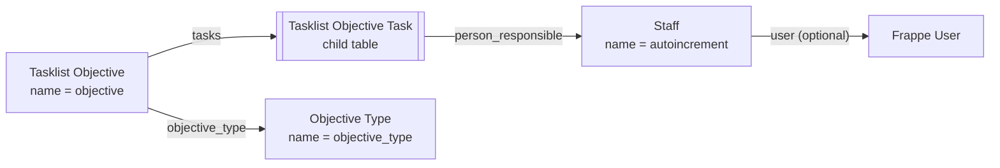

# Task List domain model

A source-derived map of the app: three standalone DocTypes and one child
table, all in the `Task List` module. Update it in the same change as any new
DocType, `Link` or `Table` field, or server-derived value.

## DocType relationships

Edge labels are the fields that create the relationship.

## Derived values

| Field | Set by | Rule |
| --- | --- | --- |
| `Tasklist Objective.status` | `TasklistObjective.before_validate` | `Closed` when there is at least one task and every task is `Done`; otherwise `Open`. A client-sent value is overwritten. See [decision 0001](decisions/0001-objective-status-derived-from-tasks.md). |
| `Staff.full_name` | `Staff.validate`, mirrored by `staff.js` for display | First and last name joined by a space. |

## Validation

- A task row's `end_date` may equal but not precede its `start_date`; dates are
  compared with `getdate`.
- Task `priority` defaults to `Low`, `type` to `Corrective` and `status` to
  `Not done`. `action_plan` and `remarks` are optional.

## Permissions

Every standalone DocType grants full access to `System Manager` only. There are
no permission-query hooks or whitelisted methods.

## Desk presentation

The public **Task List** workspace links the three standalone DocTypes and the
My Tasks and Overdue Tasks reports. Install,
the `set_default_task_list_workspace` patch and a `User.after_insert` hook make
it the default workspace of System Users who have none; an explicit choice is
kept.

`tasklist_objective.js` colours the task grid: the status cell is green when
`Done` and pink when `Not done` past its end date; the priority cell is coloured
by priority. It is display only and changes no data.

## Cross-objective task reports

Staff has an optional `user` Link to User. It grants no permissions and need not
be unique: My Tasks includes unfinished rows for every Staff linked to the
session user. No link yields empty results with setup guidance. Overdue Tasks
includes all permitted unfinished rows whose end date is before the site date.
Both standard Script Reports join child rows from permission-scoped objectives
using `frappe.qb.get_query(ignore_permissions=False)`, preserving existing
System Manager report access and User Permissions. Prepared reports are off.
The workspace links both reports; objective links open the existing editor.

Objective forms use Details and Activity tabs. Details contains all objective
fields and tasks. Activity hosts the original Frappe footer container (comments
and timeline), moved by the objective client script without replacing its
handlers or history data. New objectives show save-first guidance.
