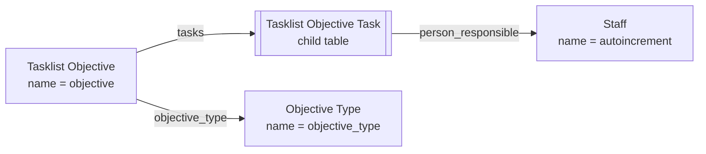

# Task List domain model

A source-derived map of the app: three standalone DocTypes and one child
table, all in the `Task List` module. Update it in the same change as any new
DocType, `Link` or `Table` field, or server-derived value.

## DocType relationships

Edge labels are the fields that create the relationship.

## Derived values

| Field | Set by | Rule |
| --- | --- | --- |
| `Tasklist Objective.status` | `TasklistObjective.before_validate` | `Closed` when there is at least one task and every task is `Done`; otherwise `Open`. A client-sent value is overwritten. See [decision 0001](decisions/0001-objective-status-derived-from-tasks.md). |
| `Staff.full_name` | `Staff.validate`, mirrored by `staff.js` for display | First and last name joined by a space. |

## Validation

- A task row's `end_date` may equal but not precede its `start_date`; dates are
  compared with `getdate`.
- Task `priority` defaults to `Low`, `type` to `Corrective` and `status` to
  `Not done`. `action_plan` and `remarks` are optional.

## Permissions

Every standalone DocType grants full access to `System Manager` only. There are
no permission-query hooks or whitelisted methods.

## Desk presentation

The public **Task List** workspace links the three standalone DocTypes. Install,
the `set_default_task_list_workspace` patch and a `User.after_insert` hook make
it the default workspace of System Users who have none; an explicit choice is
kept.

`tasklist_objective.js` colours the task grid: the status cell is green when
`Done` and pink when `Not done` past its end date; the priority cell is coloured
by priority. It is display only and changes no data.
